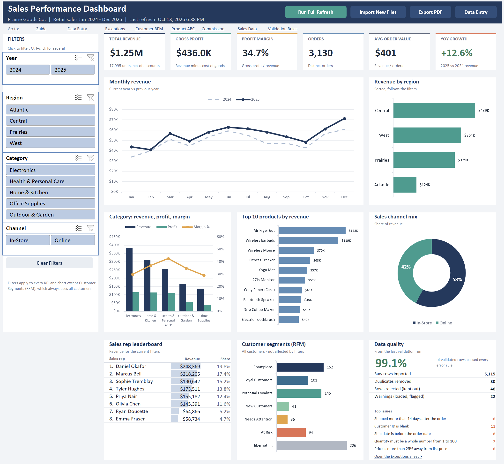
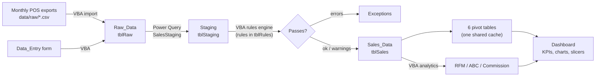

# Excel Sales Dashboard with VBA Automation

An interactive sales dashboard in Excel with an automated ETL behind it. Monthly point-of-sale exports (CSV) are imported with VBA, cleaned with Power Query, checked against a table of validation rules, loaded into one sales table and summarised in pivot tables, slicers, charts and KPI cards. One button runs the whole thing.

The data is for a fictional retailer, **Prairie Goods Co.**, selling home, outdoor, electronics, office and health products across Canada (Jan 2024 to Dec 2025, about 5,100 order lines).



---

## What it does

- **One-click refresh.** `Run Full Refresh` imports new files, runs the Power Query cleaning, validates every row, reloads the sales table, rebuilds the analysis sheets and refreshes the dashboard. Each run is written to a run log with its duration and row counts.
- **ETL with Power Query + VBA.**
  - VBA picks up every CSV in `data/raw` that isn't in the import log yet and appends it to `Raw_Data` as text (columns are matched by header name, so column order in the file doesn't matter).
  - The Power Query query `SalesStaging` trims and fixes casing, parses two date formats (`2025-03-07` and `03/07/2025`), turns `"$1,234.50"` and `"10%"` into numbers, maps every province spelling (`Sask.`, `B.C.`, `ONTARIO`, ` sk `...) to a code through an alias table, removes duplicate exports and adds product and region details from the lookup tables.
- **Data validation rules.** 15 rules live in a table on the `Validation_Rules` sheet (required fields, ranges, date checks, lookups, duplicates, price tolerance...). A VBA rules engine applies them to every row: errors keep the row out of the dashboard, warnings are loaded but flagged, and every problem goes to the `Exceptions` sheet with the rule and the bad value. On the sample data **99.1% of incoming rows pass**; the other 46 are held back with a reason.
- **Interactive dashboard.** Six KPI cards, monthly trend (this year vs last year), revenue by region, category revenue/profit/margin, top 10 products, channel mix, a sales rep leaderboard and a data quality box. Year, region, category and channel slicers filter everything at once.
- **Analysis in VBA.**
  - Customer **RFM** segmentation (recency, frequency, monetary scored 1-5, mapped to Champions, Loyal, At Risk, etc.)
  - Product **ABC / Pareto** classification
  - Quarterly **sales commission** with stepped tiers against each rep's quota
- **Standard data entry.** A `Data_Entry` form with dropdowns and Excel data validation for orders that aren't in an export, plus a macro that generates a blank upload template for stores.
- **PDF export** of the dashboard as currently filtered.

## How it works



| Step | Done by | Output |
|---|---|---|
| 1. Import | `modImport` (VBA) | `Raw_Data` + `Logs` (import log) |
| 2. Clean | `SalesStaging` (Power Query) | `Staging` |
| 3. Validate | `modValidation` (VBA) | `Exceptions` + a pass/fail status per row |
| 4. Load | `modLoad` (VBA) | `Sales_Data` with revenue, COGS, profit, margin, order flag, date parts |
| 5. Report | `modAnalytics`, `modDashboard` (VBA) | `Customer_RFM`, `Product_ABC`, `Commission`, refreshed pivots and slicers |

## Built with

- **Excel**: structured tables, pivot tables, slicers, charts, `GETPIVOTDATA`, data validation, conditional formatting, named ranges
- **Power Query (M)**: merges, custom functions, type handling, de-duplication
- **VBA**: about 2,800 lines across 10 modules

## Repository layout

```
excel-sales-dashboard-vba/
├── Sales_Performance_Dashboard.xlsm   the workbook
├── data/raw/                          24 monthly POS exports (sales_2024_01.csv ... sales_2025_12.csv)
├── power-query/SalesStaging.pq        M code for the cleaning query
├── vba/                               all VBA modules exported from the workbook
├── templates/Sales_Upload_Template.xlsx
├── docs/data_dictionary.md            every table and column
└── screenshots/
```

The VBA and M code are exported as text so they can be read and diffed on GitHub. The workbook already contains the same code.

## Getting started

1. Download or clone the repo and keep the folder structure (the import looks for `data/raw` next to the workbook).
2. Windows blocks macros in files downloaded from the internet: right-click the `.xlsm` > **Properties** > tick **Unblock** > OK.
3. Open the workbook and click **Enable Content**. The first time macros run, the slicers are added to the dashboard.
4. Click **Run Full Refresh** on the Dashboard. On the first run the macro creates the Power Query query from the M code stored on the `Settings` sheet and loads it to `Staging`.

Things to try:
- Click a few slicers: every KPI, chart and the rep leaderboard follows them.
- Add an order on `Data_Entry` with a unit price far above the list price (it loads with a warning), or submit the same order line twice (the second one is rejected as a duplicate), refresh, and find them on `Exceptions`. The form itself blocks obvious mistakes like a quantity of 0.
- Switch a rule off (`Active = N`) on `Validation_Rules` and refresh to see the effect on the data quality numbers.
- Drop a new month into `data/raw` (fill in `templates/Sales_Upload_Template.xlsx` and save it as `sales_2026_01.csv`) and refresh.

**Requirements:** Excel 2016 or Microsoft 365 for Windows (Power Query is built in). The VBA avoids Windows-only objects like `Scripting.Dictionary` and `FileSystemObject` so it can also run in Excel for Mac, and if Power Query can't run on a machine the macro offers a VBA version of the same cleaning step.

## The sample data

The 24 exports are generated sample data, made deliberately messy the way real exports are:

| Problem in the raw files | Fixed / caught by |
|---|---|
| Two date formats, `$` and thousands separators, `10%` vs `0.10` vs blank discounts | Power Query |
| Province written 70 different ways, inconsistent casing and extra spaces, sales channel written 9 ways | Power Query |
| 30 rows exported twice | Power Query (de-duplication) |
| Missing customer IDs, quantity 0 or negative, discounts over 50%, ship date before order date, unknown product codes, unrecognised provinces, impossible dates (2024-02-30), same product keyed twice on one order | Validation rules (rejected) |
| Prices more than 25% off list, shipments more than 14 days late | Validation rules (warning only) |

Result on the sample: 5,115 raw rows, 30 duplicates removed, 5,085 validated, **5,039 loaded (99.1%)**, 46 rejected, 22 warnings.

## Validation rules

| Rule | Field | Type | Severity |
|---|---|---|---|
| R01 | OrderID | Required | Error |
| R02 | OrderDate | Required (real date) | Error |
| R03 | OrderDate | DateRange 2020-01-01 to TODAY | Error |
| R04 | ShipDate | Required (real date) | Error |
| R05 | ShipDate | Compare: ShipDate >= OrderDate | Error |
| R06 | CustomerID | Required | Error |
| R07 | ProductID | Lookup in the product master | Error |
| R08 | ProvinceCode | Required (province recognised) | Error |
| R09 | Quantity | Whole number 1-100 | Error |
| R10 | UnitPrice | Range 0.01-10,000 | Error |
| R11 | Discount | Range 0-50% | Error |
| R12 | Channel | List: In-Store, Online | Error |
| R13 | OrderID+ProductID | Unique | Error |
| R14 | UnitPrice | Within 25% of list price | Warning |
| R15 | ShipDate | Shipped within 14 days | Warning |

New rules can be added as rows; the engine supports `Required`, `Range`, `WholeNumber`, `DateRange`, `Compare`, `MaxDaysAfter`, `Lookup`, `List`, `Unique` and `Tolerance`.

## Analysis logic

**RFM.** Recency = days since the customer's last order, Frequency = number of orders, Monetary = revenue. Each is scored `1 + INT(5 x share of customers with a strictly lower value)` (reversed for recency), so customers with the same value always get the same score. Segments are assigned top to bottom: Champions (R>=4, F>=4, M>=4), Loyal (R>=3, F>=4), New (R>=4, F=1), Potential Loyalists (R>=3, F>=2), At Risk (R<=2, F>=3), Hibernating (R<=2), Needs Attention (everything else).

**ABC.** Products ranked by revenue. A = the products that make up the first 80% of revenue, B = the next 15%, C = the rest.

**Commission.** Paid in slices of each rep's quarterly quota: 2% up to 80% of quota, 3% from 80-100%, 4% from 100-120% and 5% above that, so reaching a new tier only raises the rate on the revenue above it. Tiers and quotas are in the `Lookups` sheet.

## VBA modules

| Module | What it does |
|---|---|
| `modMain` | Button entry points, the full refresh, run log |
| `modImport` | Finds new CSV files, parses them (quoted fields included), appends to `tblRaw`, import log |
| `modTransform` | Creates/refreshes the Power Query query; VBA fallback with the same cleaning rules |
| `modValidation` | Rules engine |
| `modLoad` | Builds `tblSales` and its calculated columns |
| `modAnalytics` | RFM, ABC and commission |
| `modDashboard` | Pivot tables, slicers, clear filters, PDF export |
| `modDataEntry` | Data entry form and the upload template |
| `modUtils` | Table read/write helpers, named cells, paths, speed mode |
| `modHelpers` | Pure functions: CSV splitting, text/number/date parsing, sorting, scoring |

## Design notes

- **All pivots share one pivot cache** built on `tblSales`. That's what lets a single slicer filter every pivot, and the KPI cards and chart ranges read the pivots through `GETPIVOTDATA`. The charts sit on small helper ranges (hidden `Calc` sheet) so they can be sorted and keep a fixed shape when a filter removes items.
- **Rules and lookups are data, not code.** Validation rules, province spellings, product master, quotas and commission tiers are all tables that can be edited without opening the VBA editor.
- **Fast table writes.** Every step reads a table into an array, works in memory and writes the result back in one go instead of looping through cells.
- **The business logic is separated from the sheet I/O.** Functions like `ValidateData`, `BuildSalesRows` and `ComputeRFM` only work on arrays and never touch the workbook, so they can be tested on their own.
- **VBA does the import, Power Query does the cleaning.** VBA handles the folder and remembers which files are already loaded; Power Query is better at the transformations and keeps them readable as steps.

## Ideas for next steps

- Move the measures to the Data Model so orders can be a true distinct count instead of a first-line flag.
- Read the exports straight from a SharePoint/OneDrive folder.
- Rebuild the same model in Power BI and compare.

---

**Author:** Manthan Ray, [LinkedIn](https://www.linkedin.com/in/manthanray)

Sample data is fictional. Licensed under the MIT License.
